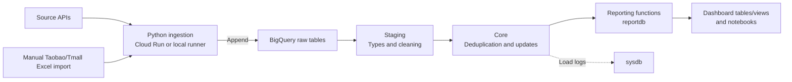

# LSOUL data warehouse

This repository brings LSOUL's sales, product, inventory, customer and advertising data into
**Google BigQuery**. Python scripts extract data from operational and marketing APIs; SQL and
Dataform transformations turn it into core business tables and reporting functions for dashboards
and analysis notebooks.

For a new team member, start with the data flow and source map below, then follow the setup and
pipeline guides for your role.

| Item | Repository context |
|---|---|
| Warehouse project | `marine-cycle-484213-b4` |
| Warehouse location | `asia-southeast1` |
| Business timezone | `Asia/Ho_Chi_Minh` (UTC+7); some scripts use the container clock instead |
| Ingestion runtime | Python scripts; Flask + gunicorn in separate Cloud Run containers |
| Transformations | BigQuery SQL, stored procedures and Dataform SQLX |
| Outputs | `reportdb` functions, dashboard tables/views and notebooks |
| Deployment and scheduling | Managed outside this repository; saved definitions are available under `sql/live/` |

> **Before running a pipeline:** scripts call live source APIs and normally append to production
> BigQuery. There is no offline pipeline mode. A supported `--dry-run` skips the load but still calls
> the source API. Use [the run guide](docs/running-pipelines.md) for the exact script and date window.

## How the pipeline works



| Stage | What happens | Where to look |
|---|---|---|
| Extract and load | Fetch paginated API responses, flatten JSON, rename columns and append rows with `WRITE_APPEND`. Most loaders cast all columns to strings. | [Cloud Run services](src/cloud_run/), [local runners](src/local_run/) |
| Raw | Keep repeated extracts, including overlapping windows and full snapshots. Many tables use ingestion-time partitioning; some are created unpartitioned by their first load. | [Pipeline destinations and schema coverage](docs/pipelines.md) |
| Staging | Convert raw strings into dates, numbers and other useful types; derive a processing date (`proc_date`) from the load partition. Definitions include SQL and Dataform SQLX. | [Staging SQL](sql/staging/), [captured Dataform source](sql/live/dataform/) |
| Core | Procedures commonly delete affected IDs and insert deduplicated records from the latest staging partition. One-off build/backfill scripts are separate. | [Procedures](sql/procedures/), [core SQL](sql/core/) |
| Reporting | Combine business data across sources, channels and countries with `reportdb.fn_*` table functions; dashboard jobs materialize tables/views. | [Functions](sql/functions/), [dashboard SQL](sql/working_files/) |
| Analysis | Dashboards and notebooks consume warehouse outputs. Notebooks were written for Colab and query BigQuery. | [Notebooks](notebooks/), [SQL guide](sql/README.md) |

**Two dates matter:** the source record's business/update date and the date it was loaded into
BigQuery. Re-fetching a window adds raw duplicates; core procedures handle deduplication. Many core
procedures only load when the newest staging partition is today's date in Vietnam time. A successful
API load therefore does not, by itself, prove that reporting data has refreshed.

### Source systems and destinations

Table names below are relative to `marine-cycle-484213-b4`; abbreviated names in each row use
the first table's dataset. This is a source-level overview;
[the pipeline inventory](docs/pipelines.md) lists every script, endpoint, flag and destination.

| Source | Data brought into the warehouse | Raw destination examples | Coverage notes |
|---|---|---|---|
| Pancake POS | Orders, customers, products/variations, inventory analytics/history and warehouse transfers | `raw_pancake.raw_order`, `raw_customer`, `raw_product_variations` | Multiple Cloud Run services and local variants; returned orders have a known Cloud Run wiring issue |
| Dianplus | Orders, refunds, inventory and SKUs | `dianplus.raw_dianplus_order`, `raw_dianplus_order_refund` | Product loader appends a full catalogue snapshot |
| Jushuitan | Orders, inventory and manual Taobao/Tmall orders | `jushuitan.raw_jushuitan_order`, `raw_jushuitan_inventory` | Cloud Run order loader; inventory and Excel import are local runners |
| Magento | Orders | `magento.raw_magento_order` | Cloud Run and local variants |
| Surfosm / ScaleUp fulfilment | Orders, returns and inventory | `surfosm.raw_surfosm_order`, `raw_surfosm_order_return`, `raw_surfosm_inventory` | Order/return services normally re-fetch 31 days |
| TikTok Ads | Ads, GMV Max and auction reports for VN and Thai accounts; ad groups/campaigns in local scripts | `raw_tiktok.raw_tiktok_ads`, `raw_tiktok_gmv_max_report`, `raw_tiktok_thai_ads` | Mix of full-object snapshots and daily reports; Thai ads service has a known startup issue |
| Meta Ads | Daily ad-level performance | `raw_meta.raw_ads_reporting_a`, `raw_ads_reporting_ecom`, `raw_ads_reporting_my` | A/ecom Cloud Run services; MY loader is local |

Pancake, TikTok and Meta generally separate layers into datasets such as `raw_pancake`,
`stg_pancake` and `core_pancake`. Dianplus, Jushuitan, Magento and Surfosm keep `raw_*`, `stg_*`
and `core_*` tables in their source dataset. Shared reporting and load logs live in `reportdb`
and `sysdb` respectively.

### Example: follow a Pancake order

1. The [Pancake order service](src/cloud_run/cloud-run-pancake-order/cr-pancake-order.py)
   fetches orders **updated yesterday**, using a Vietnam-time window and `updateStatus=updated_at`.
2. It flattens the response and appends it to `raw_pancake.raw_order`.
3. [Staging SQLX](sql/staging/stg_pancake_order.sql) builds `stg_pancake.stg_order` with typed
   fields and a processing date.
4. [sp_core_order_insert](sql/procedures/sp_core_order_insert.sql) checks the latest processing
   date, deletes matching order IDs from `core_pancake.core_order`, and inserts refreshed records.
5. Reporting functions use core data for sales and order reporting. See the example lineage in
   [the SQL guide](sql/README.md#data-flow).

Each stage has its own execution mechanism. Calling the ingestion service does not execute the
whole downstream chain.

## Scheduling and freshness

- **Ingestion:** the documented Pancake order job, `pancake-insert-raw_order`, calls `GET /` daily
  at **07:20 Vietnam time**. Other ingestion schedules are not established by the pipeline inventory;
  confirm them in Cloud Scheduler before relying on a cadence.
- **Transformations:** Dataform and BigQuery scheduled queries run SQL outside this checkout.
  The [2026-10-28 definition snapshot](sql/live/README.md) includes Dataform source/configuration
  and three scheduled-query configurations. It records captured state, not current run success.
- **Load timing:** for the documented Pancake order flow, ingestion before 07:00 Vietnam time lands
  in the previous UTC load partition, which can be excluded by the current-day staging logic.
- **Checking freshness:** trace the raw load partition, staging `proc_date`, core load logs in
  `sysdb`, and downstream dashboard refresh. See [troubleshooting](docs/troubleshooting.md).

The repository has no single local orchestrator or CI pipeline. The saved warehouse definitions
are an inventory and backup, **not a batch deployment**. Older SQL build scripts and workspace drafts
may differ from deployed definitions; read [the sync guide](docs/warehouse-definition-sync.md) for
provenance and coverage limits. Runtime schedules and IAM settings were not rechecked for this README.

## Google Cloud authorization and source access

You can read the code and run static checks without Google Cloud credentials. Running ingestion
requires both source API credentials and an identity allowed to write to the destination warehouse.

| Execution context | BigQuery authentication | Source authentication |
|---|---|---|
| Deployed Cloud Run | Application Default Credentials from the service's runtime identity | Service environment variables or Secret Manager references |
| `src/local_run/` | Repo-root `credentials/google-credentials.json`; these scripts ignore `GOOGLE_APPLICATION_CREDENTIALS` | Usually the repo-root `.env`; some TikTok scripts need variables exported in the shell |
| Cloud Run script executed locally | Usually Application Default Credentials; Pancake order uses the repo-root key when present | Environment variables / `.env` |
| Schema scripts and CSV exporters | Read `GOOGLE_APPLICATION_CREDENTIALS`; their fallback paths may be stale | Source-specific variables where applicable |

The Pancake order service documents **BigQuery Data Editor** on `raw_pancake` and **BigQuery Job User**
on the project for its runtime identity, plus access to its source secret. Deployment permissions
are separate; see [the deployment walkthrough](#deploy-and-schedule-a-cloud-run-service).

Credential variable names and placeholders are in [.env.example](.env.example). Local and Cloud Run
variants can differ (for example, Meta and TikTok token variable names); follow
[setup](docs/setup.md) and [the pipeline inventory](docs/pipelines.md). Never commit `.env` or key files.

## Local development

### Set up the environment

Use Python 3.11+ and follow [docs/setup.md](docs/setup.md) for version and dependency details.
Dependency installation requires network access; it does not run a pipeline.

```bash
python3.11 -m venv .venv
.venv/bin/pip install -r requirements.txt -r src/cloud_run/cloud-run-surfosm-inventory/requirements.txt
git config filter.nbstrip.clean "python3 scripts/nbstrip.py"
git config filter.nbstrip.smudge cat
git config filter.nbstrip.required true
```

Service dependencies live in each Cloud Run folder. The Surfosm inventory requirements cover the
common runtime packages; Pancake order has its own pinned versions. Configure credentials only
when preparing an authorized run, using [the setup guide](docs/setup.md#2-credentials-local-only).

### Validate without accessing production

```bash
python3 scripts/validate_repo.py
python3 -m unittest discover -s tests
# With pipeline dependencies installed:
.venv/bin/python -m unittest discover -s tests
.venv/bin/python scripts/validate_repo.py --imports
```

The import check disables dotenv, uses dummy credentials and blocks sockets in isolated subprocesses.
A warning for the known `cloud-run-tiktok-thai-ads` wiring issue is expected.

### Run a pipeline

Choose the exact source, date window and destination from [docs/pipelines.md](docs/pipelines.md),
then follow [docs/running-pipelines.md](docs/running-pipelines.md). Flags vary by script;
`local_run/` has no general dry-run flag. Read the CLI definition rather than executing `--help`,
because imports can load credentials and some exporters execute at import time.

Each Cloud Run service is built from its own folder and exposes a Flask app through
`app_runner.py`. A request to `/` normally triggers ingestion; it is not a health check.
The repository does not have one shared application or a common `/sync` endpoint.

## Repository layout

```text
.
├── src/
│   ├── cloud_run/          30 service folders; each is a separate Docker build context
│   ├── local_run/          Local CLI loaders, including manual Excel import
│   ├── csv_export/         Manual exporters; source API calls, no BigQuery loads
│   └── schema/             Raw-table creation scripts; drop and recreate tables
├── sql/
│   ├── staging/, core/    Transformations and one-off builds/backfills
│   ├── procedures/        Incremental core loads, logging and dashboard jobs
│   ├── functions/         Reporting table functions and shared UDFs
│   ├── live/              Captured warehouse definitions and pipeline source
│   ├── working_files/     Dashboard deployment sets and scratch SQL
│   └── ad_hoc/, archive/  One-off queries and superseded SQL
├── notebooks/             Analysis notebooks; outputs stripped in Git
├── scripts/, tests/       Repository tooling and offline checks
├── docs/                  Architecture, inventory, setup and runbooks
├── AGENTS.md / CLAUDE.md   Guidance for coding agents
├── .agents/skills/        Canonical agent skills; .claude/skills/ links to them
└── seeds/, data/, credentials/, .env   Local inputs, outputs and secrets; gitignored
```

## Known limitations

- `cloud-run-tiktok-thai-ads` points to a missing Python filename and cannot start as checked in.
- `cloud-run-pancake-order_returned` fetches ordinary orders into `raw_pancake.raw_order`;
  the local returned-order loader uses the actual returned-order endpoint and table.
- Some services return HTTP 500 on empty results. Several scripts use the container clock for
  default dates, and some historical deployment examples have stale paths or service names.
- Schema scripts delete and recreate raw tables. They are not an onboarding or validation step.

See [the troubleshooting guide](docs/troubleshooting.md#known-issues) before operating a service.

## Documentation and extending the pipeline

| If you want to… | Read |
|---|---|
| Understand design choices | [Architecture](docs/architecture.md) |
| Find a script, endpoint, window or destination | [Pipeline inventory](docs/pipelines.md) |
| Set up a machine | [Setup](docs/setup.md) |
| Run or debug a pipeline | [Run guide](docs/running-pipelines.md), [troubleshooting](docs/troubleshooting.md) |
| Add a source or endpoint | [Adding a source](docs/adding-a-source.md) |
| Work on warehouse SQL | [SQL guide](sql/README.md), [captured definitions](sql/live/README.md) |
| Refresh the definition snapshot | [Warehouse definition sync](docs/warehouse-definition-sync.md) |
| Work as a coding agent | [AGENTS.md](AGENTS.md), [CLAUDE.md](CLAUDE.md) |
| Understand the repository restructure | [Migration notes](docs/restructure-2026-10.md) |

When extending a pipeline, keep each Cloud Run folder self-contained, consider matching local/CSV
variants, update the inventory and any affected schemas/SQL, then run the offline checks above.

## Deploy and schedule a Cloud Run service

Worked example: `cloud-run-pancake-order`, which loads orders updated yesterday into
`raw_pancake.raw_order`. This walkthrough documents the setup recorded for that service;
confirm current configuration before reuse. Deployment, secret and scheduler changes affect
production. Run commands from the repo root.

**Before you start**

- Install the gcloud CLI and sign in (`gcloud auth login`) with an account that can deploy in
  `marine-cycle-484213-b4`. It needs Cloud Run Source Developer, Service Usage Consumer, Service Account
  User on the runtime service account, Secret Manager Admin and Cloud Scheduler Admin.
- If the upload fails with `serviceusage.services.use` denied, your gcloud quota project points at another
  project. Add `--billing-project marine-cycle-484213-b4` to each command, or run
  `gcloud config set billing/quota_project marine-cycle-484213-b4`.
- Since the 2026-10 restructure, scripts read credentials from environment variables. Images built
  earlier may have none set, so check a service before you redeploy it:
  `gcloud run services describe <service> --region asia-southeast1 --format="yaml(spec.template.spec.containers[0].env)"`.

**1. Store the API key in Secret Manager** (once; `pancake_pos` already exists). Type the key at the
prompt so it never appears in your shell history or a chat:

```zsh
read -s "PANCAKE_KEY?Pancake API key: " && echo && \
printf '%s' "$PANCAKE_KEY" | gcloud secrets create pancake_pos --data-file=- \
  --replication-policy=automatic --project marine-cycle-484213-b4; unset PANCAKE_KEY
gcloud secrets add-iam-policy-binding pancake_pos --project marine-cycle-484213-b4 \
  --member serviceAccount:266174294882-compute@developer.gserviceaccount.com \
  --role roles/secretmanager.secretAccessor
```

That `read` syntax is zsh; in bash use `read -s -p "Pancake API key: " PANCAKE_KEY`. To rotate the key,
use `gcloud secrets versions add pancake_pos --data-file=-` the same way. The service reads `:latest` when
a new revision starts.

**2. Deploy.** First run the offline checks
(`.venv/bin/python -m unittest tests.test_cloud_run_pancake_order` and
`uvx ruff@0.17.2 check src/cloud_run/cloud-run-pancake-order`). Cloud Build then builds the
folder's Dockerfile, which takes a few minutes:

```bash
gcloud run deploy pancake-order --source src/cloud_run/cloud-run-pancake-order \
  --project marine-cycle-484213-b4 --region asia-southeast1 --no-allow-unauthenticated \
  --update-secrets PANCAKE_API_KEY=pancake_pos:latest \
  --timeout 1800 --concurrency 1 --max-instances 1 --memory 1Gi
```

`--concurrency 1 --max-instances 1` limits concurrent requests. It does not make loads idempotent:
retries or repeated requests can still append the same orders again.

**3. Schedule.** The job `pancake-insert-raw_order` already exists: `GET /` daily at 07:20 Vietnam
time, 1800s deadline, 1 retry. Run `gcloud scheduler jobs list --location asia-southeast1` first, and
create a job only for a service that has none:

```bash
gcloud scheduler jobs create http <job-name> --project marine-cycle-484213-b4 --location asia-southeast1 \
  --schedule "20 7 * * *" --time-zone Asia/Ho_Chi_Minh --uri <service-url>/ --http-method GET \
  --attempt-deadline 1800s --max-retry-attempts 1 --min-backoff 600s
```

- Get `<service-url>` from
  `gcloud run services describe <service> --region asia-southeast1 --format="value(status.url)"`.
- Schedule after 07:00 Vietnam time. Raw tables are partitioned by UTC load time, and staging reads only
  today's Vietnam-date partition, so an earlier load is skipped downstream.
- These services have the invoker IAM check disabled, so jobs send no token. If a service enforces IAM,
  add `--oidc-service-account-email <sa>` and grant that account `roles/run.invoker` on the service.

**4. Optional live smoke test.** This historical window is expected to return no orders.
It still calls the Pancake API and is not a dry run: if records are returned, they will be loaded.

```bash
curl -sS -w "\nHTTP %{http_code}\n" "<service-url>/?start_date=2010-01-01T00:00:00&end_date=2010-01-01T00:00:01"
# Expected: "0 entry found. No data to export." and HTTP 200
```

**Check a scheduled run:**
`gcloud scheduler jobs describe pancake-insert-raw_order --location asia-southeast1 --project marine-cycle-484213-b4 --format="value(status,lastAttemptTime)"`
prints `{}` as the status when the last run succeeded. Logs are in the Cloud Run console. Every run
appends, so triggering the job or `/?start_date=…&end_date=…` for a window that's already loaded adds
duplicate rows.

## Security

- Credentials live only in `.env` (local) or Cloud Run environment variables / Secret Manager.
  `scripts/validate_repo.py` fails on the common hardcoded-credential patterns (a guardrail, not a
  complete secret scanner; still review diffs).
- `credentials/`, `.env`, `seeds/*.xlsx`, `data/` and notebook outputs are kept out of Git.
- Before publishing this repository, follow [docs/portfolio_checklist.md](docs/portfolio_checklist.md).
  The portfolio README draft is kept in [docs/portfolio-readme-template.md](docs/portfolio-readme-template.md).

## License

MIT unless the code belongs to an employer/client or other rights holder. See [LICENSE](LICENSE).
