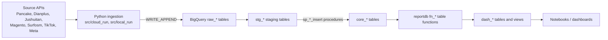

# Architecture

## Data flow

The editable, more detailed diagram is [architecture.mmd](architecture.mmd).

1. **Extraction and load (Python, `src/`).** Each pipeline fetches one API endpoint (paginated,
   usually for a date window in Vietnam time), flattens the JSON with `pandas.json_normalize`,
   renames columns through a per-script `COLUMN_RENAME_MAP`, casts everything to strings and
   appends it to a raw BigQuery table with `load_table_from_dataframe` (`WRITE_APPEND`,
   `ALLOW_FIELD_ADDITION`). Raw tables are ingestion-time partitioned (`_PARTITIONTIME`).
2. **Staging (`sql/staging/`).** `CREATE OR REPLACE TABLE` scripts (two are Dataform SQLX) cast
   raw strings to types and derive `proc_date` from `_PARTITIONTIME`.
3. **Core (`sql/procedures/`, `sql/core/`).** `sp_*_insert` procedures load the latest staging
   partition into core tables by deleting the affected IDs and reinserting them (deduplicating on
   the way), and log to `sysdb`. `sql/core/` holds one-off build/backfill scripts.
4. **Reporting (`sql/functions/`, `sql/working_files/`).** `reportdb.fn_*` table functions
   combine sources by channel and country; the AI performance dashboard set builds `dash_*` tables.
5. **Analysis (`notebooks/`).** Notebooks query the reporting layer (they were written for Colab).

Details per pipeline: [pipelines.md](pipelines.md). Details per SQL layer: [../sql/README.md](../sql/README.md).

## Runtime and deployment

- **Cloud Run services** (`src/cloud_run/<service>/`): each folder is a Docker build context
  (`python:3.11-slim`, `gunicorn app_runner:app`). `app_runner.py` loads the hyphenated `cr-*.py`
  module by file path and exposes its Flask `app`. A request to `/` runs the export with the
  script's default date window. `cloud-run-surfosm-inventory` also has a Cloud Functions entry
  point (`main.py`).
- **Authentication to BigQuery:** Cloud Run services use Application Default Credentials (the
  service's identity). Local scripts use a service-account key file (`GOOGLE_APPLICATION_CREDENTIALS`).
- **Source credentials:** environment variables (see [../.env.example](../.env.example)). Locally
  they come from the gitignored `.env` via `load_dotenv()`; on Cloud Run they must be set as service
  env vars or Secret Manager references.
- **Scheduling:** not defined in this repository. The SQL implies a daily cadence (procedures only load
  when the newest staging partition is today's date in Vietnam time), and one archived SQL file mentions a
  BigQuery scheduled query at 06:00 ICT. Dataform runs at least part of the SQL. Treat schedules as
  **unknown** until they are confirmed in Cloud Scheduler / BigQuery scheduled queries / Dataform.

## Why the code is shaped this way

- **One script per endpoint with heavy duplication.** Each Cloud Run image copies only its own
  folder, so services can't share a local module without changing every Dockerfile and build
  context. A shared library is a worthwhile future step (see below) but it changes deployment, so
  it was deliberately left out of the 2026-10 restructure.
- **Everything is STRING in raw.** Loads cast every column to string and rely on staging SQL for
  types, which keeps loads tolerant to API changes (`ALLOW_FIELD_ADDITION`) at the cost of typing later.
- **Append-only raw + overlapping windows.** Pipelines re-fetch recent days (often the last 30)
  to catch late updates; duplicates are removed in core, not in raw or staging.

## Optional future improvements (not implemented)

These are separate from the restructure and each needs a decision and a deployment plan:

1. Extract a shared `lsoul_ingest` package (API pagination, flattening, BigQuery load) and build
   Cloud Run images from the repo root so services can import it.
2. Store source credentials in Secret Manager and reference them from Cloud Run.
3. Add CI that runs `scripts/validate_repo.py` and the tests.
4. Version scheduling (Cloud Scheduler / scheduled queries / Dataform) in the repo.
5. Consolidate `local_run/` and `csv_export/` variants into flags on the Cloud Run scripts.
6. Fix the naming typos (`autction`, `wholeshale`) together with their deploy configuration.
