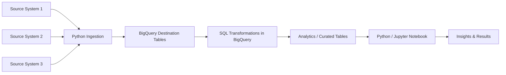

> Portfolio README template (moved from the repo root on 2026-10-18 when the root README was
> rewritten to describe the actual pipelines). Links are relative to docs/. Fill in the placeholders before publishing.


# LSOUL — Cloud Data Warehouse Portfolio Project

> **Recruiter summary:** LSOUL is a cloud-based data warehouse project built on Google BigQuery. Python is used for data ingestion from multiple source systems and destination-table creation, SQL is used for in-warehouse data transformation, and a Python/Jupyter notebook presents the resulting analysis.

**Status:** [Completed / In progress]

**Role:** [YOUR ROLE]

**Project period:** [MONTH YEAR – MONTH YEAR]

**Repository purpose:** Portfolio demonstration. Any production credentials, proprietary data, and sensitive identifiers must be removed or replaced with placeholders before publishing.

---

## 1. Project Overview

LSOUL demonstrates an end-to-end analytics engineering / data engineering workflow in which data moves from multiple source systems into a centralized cloud data warehouse on Google BigQuery.

### What the project demonstrates

- **Ingestion:** Python fetches data from multiple source systems.
- **Warehouse setup:** Python creates the destination tables in BigQuery.
- **Transformation:** SQL transforms data inside BigQuery rather than performing all transformations in Python.
- **Analysis:** A Python/Jupyter notebook presents analysis results in a notebook-style format.

### Business / analytical objective

[DESCRIBE THE BUSINESS QUESTION OR DECISION THIS DATA WAREHOUSE SUPPORTS]

### Data sources

- [DATA SOURCE NAME 1] — [PUBLIC / PROPRIETARY / REDACTED]
- [DATA SOURCE NAME 2] — [PUBLIC / PROPRIETARY / REDACTED]
- [DATA SOURCE NAME 3] — [PUBLIC / PROPRIETARY / REDACTED]

> For proprietary work, keep source names generic (for example, `[CRM SYSTEM]`) unless you have explicit permission to disclose them.

---

## 2. Architecture



See [`docs/architecture.mmd`](architecture.mmd) for the editable architecture diagram.

### Design choice

The project intentionally separates responsibilities:

1. **Python** handles source extraction and destination-table creation.
2. **BigQuery SQL** handles warehouse-side transformation.
3. **Notebook analysis** focuses on interpreting the transformed data and communicating insights.

---

## 3. Tech Stack

| Area | Technology | Purpose |
|---|---|---|
| Programming | Python | Data ingestion and BigQuery table creation |
| Warehouse | Google BigQuery | Cloud data warehouse and transformation layer |
| Transformation | SQL | In-warehouse transformations |
| Analysis | Jupyter Notebook | Exploratory analysis, visualization, and communication |
| Version control | Git + GitHub | Source control and portfolio presentation |

---

## 4. Repository Structure

```text
LSOUL/
├── README.md
├── LICENSE
├── .gitignore
├── .env.example
├── requirements.txt
├── src/
│   ├── __init__.py
│   └── README.md
├── sql/
│   ├── README.md
│   ├── staging/
│   ├── marts/
│   └── checks/
├── notebooks/
│   └── 01_lsoUL_analysis_template.ipynb
├── docs/
│   ├── architecture.mmd
│   └── portfolio_checklist.md
└── data/
    ├── raw/
    └── processed/
```

Keep real or sensitive datasets out of the repository. Use small synthetic/sample data only when it is legally and technically safe to do so.

---

## 5. Setup

### Prerequisites

- Python [VERSION, e.g. 3.11]
- A Google Cloud project with BigQuery access
- Git
- A GitHub account

### 1) Clone the repository

```bash
git clone https://github.com/[GITHUB-USERNAME]/[REPOSITORY-NAME].git
cd [REPOSITORY-NAME]
```

### 2) Create a virtual environment

macOS / Linux:

```bash
python3 -m venv .venv
source .venv/bin/activate
```

Windows PowerShell:

```powershell
python -m venv .venv
.venv\Scripts\Activate.ps1
```

### 3) Install dependencies

```bash
python -m pip install --upgrade pip
pip install -r requirements.txt
```

### 4) Configure Google Cloud access

Copy the example configuration file:

```bash
cp -n .env.example .env
```

Then fill in the values locally. **Do not commit `.env` or service-account JSON keys.**

Use the authentication method appropriate for your environment, such as Application Default Credentials or another approved Google Cloud authentication mechanism. See the code comments/placeholders in `src/`.

### 5) Run the ingestion code

```bash
python src/[YOUR_INGESTION_SCRIPT].py
```

### 6) Run SQL transformations

Open the relevant files under `sql/` and execute them in BigQuery in the documented order.

### 7) Run the notebook

```bash
jupyter lab
```

Open the notebook under `notebooks/` and run the cells from top to bottom.

---

## 6. Results / Impact

Replace this section with measurable outcomes. Do **not** invent metrics.

### Technical outcomes

- [NUMBER] source systems integrated.
- [NUMBER] BigQuery destination tables created.
- [NUMBER] transformation models / SQL scripts implemented.
- [NUMBER] analytical tables / views produced.
- [TIME / COST / DATA QUALITY IMPROVEMENT, IF MEASURED]

### Business / analytical outcomes

- [KEY INSIGHT OR DECISION ENABLED]
- [KEY INSIGHT OR DECISION ENABLED]
- [KEY PERFORMANCE IMPROVEMENT, IF MEASURED]

### Example recruiter-facing wording

> “Built an end-to-end cloud data warehouse workflow using Python, SQL, and BigQuery. I automated data ingestion from multiple sources, created destination tables in BigQuery, performed transformations directly in the warehouse, and used a Jupyter notebook to turn the curated data into analytical insights.”

---

## 7. Key Engineering Decisions

### Why transform in BigQuery?

[EXPLAIN WHY THE PROJECT USES WAREHOUSE-SIDE SQL TRANSFORMATIONS — FOR EXAMPLE, CENTRALIZED LOGIC, SCALABILITY, OR CLEAR SEPARATION BETWEEN INGESTION AND TRANSFORMATION.]

### Why use Python for ingestion?

[EXPLAIN THE SOURCE-SYSTEM ACCESS / API / FILE / SCHEDULING REASON THAT MADE PYTHON APPROPRIATE.]

### Why use a notebook?

[EXPLAIN HOW THE NOTEBOOK HELPS COMMUNICATE THE ANALYSIS, VALIDATE RESULTS, OR SHARE INSIGHTS.]

---

## 8. Data Security & Privacy

This repository is designed to be safe for portfolio publication only after a final review.

Never commit:

- Google Cloud service-account JSON files
- API keys or access tokens
- `.env` files containing secrets
- Passwords or connection strings
- Proprietary raw datasets
- Confidential customer information
- Internal URLs, hostnames, or identifiers that are not approved for disclosure

Replace sensitive identifiers with placeholders such as `[GCP_PROJECT_ID]`, `[BQ_DATASET]`, `[SOURCE_SYSTEM]`, and `[TABLE_NAME]`.

---

## 9. Notebook

GitHub renders `.ipynb` files as static notebook pages. Interactive JavaScript elements may not work in the GitHub view; use nbviewer when you need richer notebook interactivity. See the notebook in [`notebooks/`](../notebooks/).

Optional future enhancement: publish a polished project page with GitHub Pages once the repository is fully sanitized.

---

## 10. Future Improvements

- [ ] Add automated data-quality checks.
- [ ] Add orchestration / scheduling.
- [ ] Add unit tests for transformation logic.
- [ ] Add CI checks with GitHub Actions.
- [ ] Add a polished architecture diagram.
- [ ] Add a public demo dataset or synthetic dataset.

---

## 11. Contact

**Author:** [YOUR NAME]

**LinkedIn:** [YOUR LINKEDIN URL]

**Portfolio:** [YOUR PORTFOLIO URL]

**Email:** [YOUR PROFESSIONAL EMAIL]

---

## License

This project is released under the MIT License unless the code belongs to an employer/client or other rights holder. See [`LICENSE`](../LICENSE).
